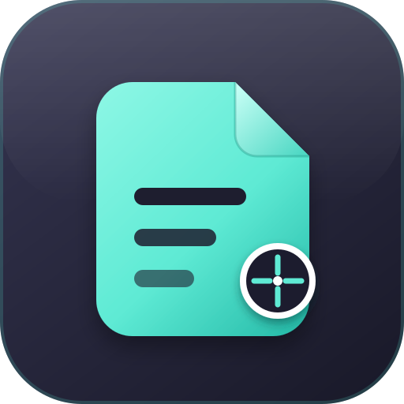
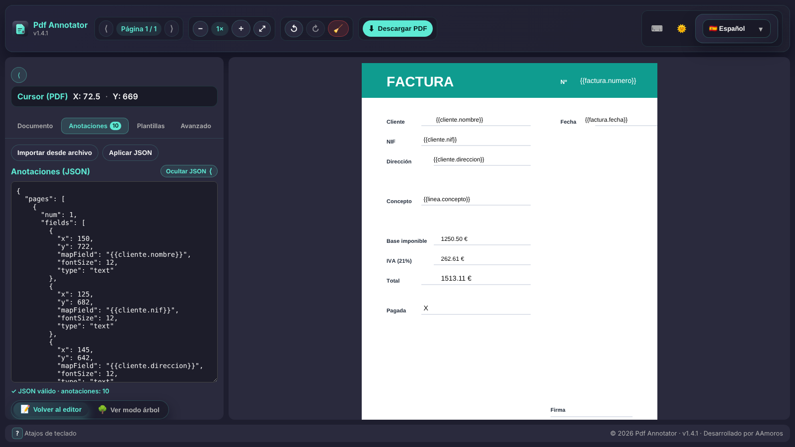
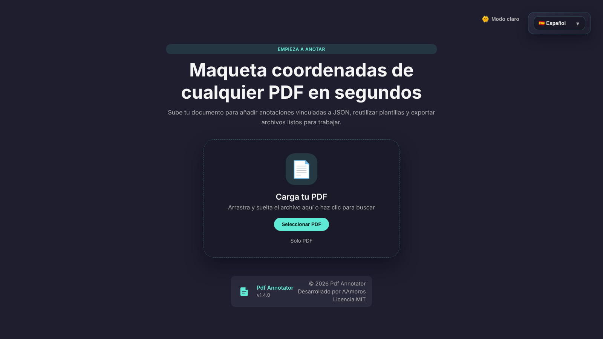
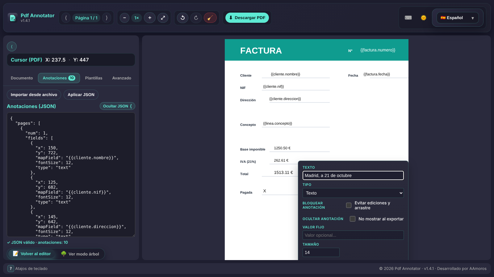
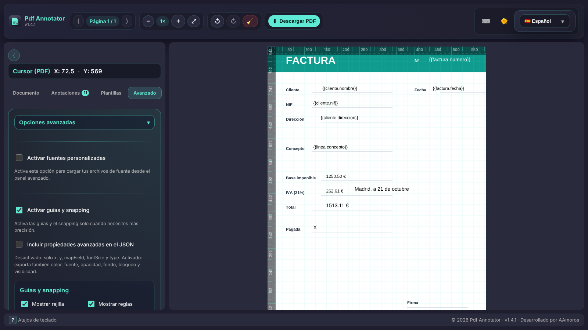
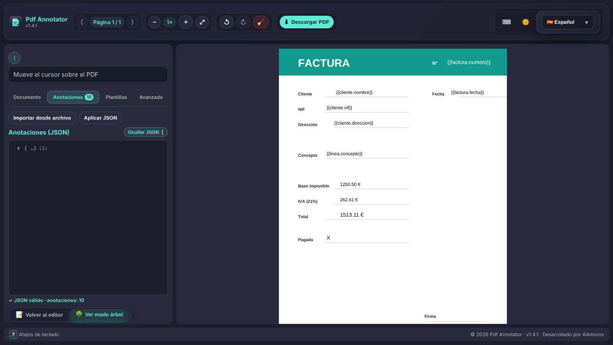
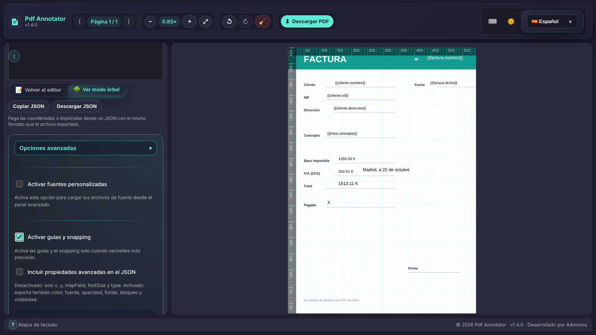
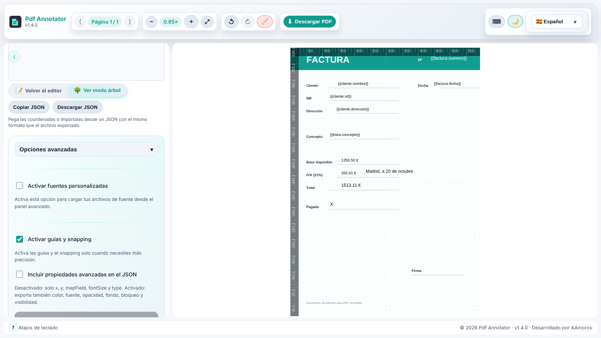
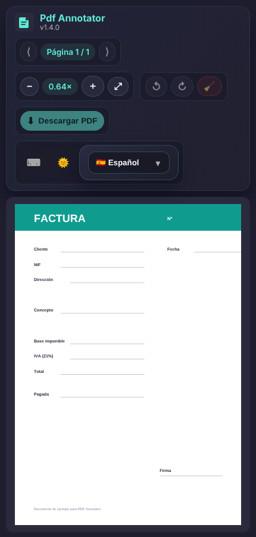

<p align="center">
  
</p>

<h1 align="center">PDF Annotator</h1>

<p align="center">
  <strong>Marca cualquier PDF, obtén las coordenadas exactas en JSON y exporta el documento anotado.</strong><br />
  100 % en tu navegador · sin subir archivos · 7 idiomas · tema claro y oscuro
</p>

<p align="center">
  <a href="CHANGELOG.md"></a>
  <a href="LICENSE"></a>
  
  
</p>

<p align="center">
  
  
  
  <a href="https://github.com/ElMaxter99/pdf-annotator/stargazers"></a>
</p>

<p align="center">
  <a href="#-qué-es">Qué es</a> ·
  <a href="#-empieza-en-1-minuto">Empieza</a> ·
  <a href="#-tour-de-la-interfaz">Tour</a> ·
  <a href="#-flujos-de-trabajo">Flujos</a> ·
  <a href="#%EF%B8%8F-atajos-de-teclado">Atajos</a> ·
  <a href="#-formato-json">JSON</a> ·
  <a href="#-despliegue">Despliegue</a> ·
  <a href="AGENTS.md">Para agentes</a>
</p>

<p align="center">
  
</p>

---

## 🎯 Qué es
PDF Annotator es un editor visual de **coordenadas sobre PDFs**. Haces clic donde quieres un dato, le das un nombre (`{{cliente.nombre}}`) y la app te devuelve su posición exacta en **puntos PDF**, lista para que tu backend rellene el documento (facturas, contratos, formularios, certificados…). También puede **estampar** los textos en el propio PDF.

**¿Para quién?**
- Desarrolladores que generan PDFs desde plantillas y necesitan saber *dónde* escribir cada campo.
- Equipos de QA/operaciones que quieren rellenar o revisar formularios sin editores pesados.
- Cualquiera que necesite marcar texto, checks o importes sobre un PDF sin tocar el original.

## ✨ Qué puedes hacer
| | |
| --- | --- |
| 🎯 **Colocar** | Clic sobre el PDF para crear textos, *checks*, *radios* o números con formato (decimales y sufijo, p. ej. `1250.50 €`). |
| 🖱️ **Mover y editar** | Selecciona varias con `Shift`+clic y muévelas, alinéalas (izquierda, centro, derecha, arriba, medio, abajo), duplícalas o bórralas de una vez. Arrastra anotaciones, edita fuente, tamaño, color (selector/HEX/RGB), opacidad y fondo. Bloquea u oculta las que no quieres tocar o exportar. |
| 📐 **Ser preciso** | Rejilla, reglas, guías de alineación e *imán* a rejilla, márgenes, centros o puntos propios. Coordenadas PDF o de canvas. |
| 🧾 **JSON en vivo** | Editor de texto y vista de árbol sincronizados. Pega, importa, copia o descarga. |
| 🧩 **Plantillas** | Guarda conjuntos de anotaciones y recárgalos en otros documentos. |
| ⬇️ **Exportar** | JSON (`coords.json`) o PDF anotado (`annotated.pdf`) con fuentes estándar o propias (`.ttf/.otf/.woff/.woff2`). |
| ⌨️ **Ir rápido** | Atajos para páginas, zoom, ajuste al ancho, deshacer/rehacer y más. Pulsa `?` para verlos. |
| 🌍 **A tu manera** | Español, inglés, catalán, francés, italiano, portugués y alemán; tema claro/oscuro; responsive hasta móvil. |
| 🔒 **Privado** | El PDF no sale de tu navegador. No hay servidor de procesado ni cuentas. |

## 🚀 Empieza en 1 minuto
```bash
git clone https://github.com/ElMaxter99/pdf-annotator.git
cd pdf-annotator
npm install
npm run start:local      # → http://localhost:4200
```
Requisitos: **Node 22.12** y un navegador moderno. ¿Prefieres contenedor? `npm run start:docker` → <http://localhost:4444>.

> 💡 **Pruébalo ya con los ejemplos incluidos:** carga [`examples/factura-ejemplo.pdf`](examples/factura-ejemplo.pdf) y luego **Importar desde archivo** → [`examples/anotaciones-ejemplo.json`](examples/anotaciones-ejemplo.json).

## 🧭 Tour de la interfaz
### 1 · Pantalla de bienvenida
Arrastra un PDF o haz clic para seleccionarlo. El idioma se cambia arriba a la derecha.

<p align="center"></p>

### 2 · Espacio de trabajo
<p align="center"></p>

| Zona | Qué hay |
| --- | --- |
| **Cabecera** (una fila) | Página anterior/siguiente · zoom `−`/`+`/**Ajustar** · deshacer/rehacer/limpiar · **Descargar PDF** · **Atajos** · tema · idioma. |
| **Panel lateral** (4 pestañas) | Cursor en coordenadas PDF siempre visible, y debajo: **Documento** (cambiar de PDF, miniaturas) · **Anotaciones** (editor JSON en texto o árbol, importar/aplicar, copiar, descargar; con contador) · **Plantillas** · **Avanzado** (fuentes, guías y campos extra del JSON). Se navega con ratón o flechas ←/→. Se minimiza con `B`. |
| **Visor** | Página con capa de anotaciones. Clic para crear, clic sobre una anotación para editarla, arrastrar para moverla. Scroll propio. |
| **Pie** | Recordatorio de `?` y versión. |

### 3 · Edita cada anotación
Texto (`mapField`), tipo, bloqueo/ocultar, valor fijo, decimales y sufijo (números), tamaño, opacidad, fuente (buscador), fondo y color. Los botones permiten **duplicar** ⧉, **borrar** 🗑️, confirmar ✅ o cancelar ❌.

<p align="center"></p>

### 4 · Guías y precisión
En **Opciones avanzadas → Activar guías y snapping** aparecen rejilla, reglas en puntos PDF y líneas de alineación.

<p align="center"></p>

### 5 · JSON en modo árbol
Alterna entre editor de texto y árbol; al seleccionar una anotación en el visor, el editor JSON enfoca su bloque.

<p align="center"></p>

### 6 · Atajos, tema claro y móvil
<p align="center">
  
  
</p>
<p align="center"></p>

## 🔄 Flujos de trabajo
### A · Mapear una factura para tu backend
1. Carga `factura-ejemplo.pdf` (o tu plantilla).
2. Pulsa **`0`** para ajustar al ancho. Haz clic junto a *Cliente*, escribe `{{cliente.nombre}}`, `Enter`.
3. Repite para NIF, fecha, importes. Para importes elige tipo **Número**, 2 decimales y sufijo ` €`.
4. Activa **guías** para alinear campos a la misma línea base.
5. **Descargar JSON** → entrega `coords.json` a tu servicio de generación.

```json
{ "pages": [ { "num": 1, "fields": [
  { "x": 150, "y": 722, "mapField": "{{cliente.nombre}}", "fontSize": 12, "type": "text" },
  { "x": 160, "y": 402, "mapField": "1513.11", "fontSize": 14, "type": "number" }
] } ] }
```

### B · Rellenar un PDF y descargarlo
1. Carga el PDF → crea anotaciones con el **texto final** (o usa *Valor fijo*).
2. Marca *checks* para casillas (se pintan como `X`).
3. **Descargar PDF** → `annotated.pdf` con las marcas estampadas. El original no se modifica.

### C · Reutilizar con plantillas
1. Con tus anotaciones hechas, escribe un nombre en **Plantillas reutilizables** → **Guardar plantilla**.
2. En otro PDF similar: selecciona la plantilla → **Cargar**.
3. Ajusta posiciones arrastrando y exporta. (Las plantillas viven en el `localStorage` de tu navegador.)

### D · Editar a mano o desde código
1. Abre el editor JSON, pega coordenadas (acepta JSON "flexible": comillas simples, claves sin comillas, comentarios y comas finales).
2. Se aplican solas tras una pausa, o con **Aplicar JSON** / `Ctrl/⌘ + S`.
3. Usa **Importar desde archivo** para cargar un `.json` completo (máx. 5 MB).

### E · Revisión de un PDF largo
Miniaturas para saltar de página, `←/→` para navegar, `+/−` para zoom, **Deshacer** (`Ctrl/⌘+Z`) ante cualquier error y **Limpiar** para empezar de cero.

## ⌨️ Atajos de teclado
Pulsa **`?`** (o el botón **Atajos**) para verlos en la app.

| Atajo | Acción |
| --- | --- |
| `←` / `→` · `PgUp` / `PgDn` | Página anterior / siguiente |
| `Home` / `End` | Primera / última página |
| `+` / `−` | Acercar / alejar |
| `0` | Ajustar el PDF al ancho disponible |
| `B` | Mostrar u ocultar la barra lateral |
| `Enter` | Confirmar la anotación en curso |
| `Esc` | Cancelar la tarjeta activa / cerrar la ayuda |
| `Ctrl/⌘ + Z` · `Ctrl/⌘ + Y` | Deshacer / rehacer |
| `Ctrl/⌘ + S` | Aplicar el JSON del editor |
| `Shift + clic` | Añadir o quitar una anotación de la selección |
| `Ctrl/⌘ + A` | Seleccionar todas las anotaciones de la página (las bloqueadas no) |
| `←` `↑` `→` `↓` | Mover la selección 1 pt (`Shift`: 10 pt) |
| `Supr` | Eliminar la selección |
| `Ctrl/⌘ + C` · `V` · `D` | Copiar, pegar o duplicar la selección |
| `Esc` | Quitar la selección |

Los atajos de una sola tecla se ignoran mientras escribes en un campo.

## 🧾 Formato JSON
```json
{
  "pages": [
    {
      "num": 1,
      "fields": [
        { "x": 120.5, "y": 450.25, "mapField": "Firma", "fontSize": 14, "type": "text" }
      ]
    }
  ]
}
```
| Campo | Descripción |
| --- | --- |
| `x`, `y` | Puntos PDF. Origen en la **esquina inferior izquierda**. |
| `mapField` | Texto (o clave) que se pinta/mapea. |
| `fontSize` | Puntos (por defecto 14). |
| `type` | `text` · `check` · `radio` · `number`. |
| *avanzados* (opcional) | `color` (`#RRGGBB`), `fontFamily`, `opacity` (0.1–1), `backgroundColor`, `value`, `decimals`, `appender`, `locked`, `hidden`. Actívalos con **Incluir propiedades avanzadas en el JSON**. |

Se acepta también un array directo de páginas. Detalle del modelo en [`docs/ARCHITECTURE.md`](docs/ARCHITECTURE.md).

## 🧰 Stack
| Frontend | PDF | Calidad |
| --- | --- | --- |
| Angular 20 · signals · standalone · SCSS | `pdfjs-dist` (render) · `pdf-lib` + `fontkit` (export) | Karma/Jasmine · i18n check · Prettier |

## 🐳 Despliegue
```bash
npm run build                 # genera dist/pdf-annotator/browser
npm run start:docker          # NGINX en http://localhost:4444
sh scripts/docker-down.sh     # detener
```
`nginx.conf` incluye cabeceras de seguridad (CSP, `nosniff`, `X-Frame-Options`, `Referrer-Policy`, `Permissions-Policy`). Si añades scripts de terceros (p. ej. analíticas), amplía la CSP.

## 🔐 Seguridad y privacidad
- El PDF y las anotaciones **no se envían a ningún servidor**. Se guardan solo en tu navegador: plantillas, idioma y tema (`localStorage`) y la **última sesión** (PDF + anotaciones, `IndexedDB`) para retomarla desde la portada; puedes descartarla con un clic.
- El JSON pegado se interpreta con un parser propio **sin evaluar código**.
- Límites de importación: JSON ≤ 5 MB; solo PDFs y fuentes `.ttf/.otf/.woff/.woff2`.

## 🛠️ Desarrollo
| Comando | Descripción |
| --- | --- |
| `npm run start:local` | Servidor de desarrollo (4200) |
| `npm run build` | Comprueba traducciones y compila |
| `npm test` | Pruebas unitarias (Karma/Jasmine) |
| `npm run test:ci` | Igual, headless y sin sandbox (como en CI) |
| `npm run e2e` | Pruebas end-to-end con Playwright sobre el build de producción |
| `npm run i18n:check` | Claves de los 7 idiomas coherentes |
| `node scripts/generate-example.mjs` | Regenera el PDF de ejemplo |

Estructura, convenciones y trampas conocidas: [`AGENTS.md`](AGENTS.md) (para personas y agentes de IA) y [`docs/ARCHITECTURE.md`](docs/ARCHITECTURE.md). Hoja de ruta: [`PROPUESTA_MEJORAS.md`](PROPUESTA_MEJORAS.md). Cómo contribuir: [`CONTRIBUTING.md`](CONTRIBUTING.md).

## 🧯 Solución de problemas
| Síntoma | Qué hacer |
| --- | --- |
| El PDF no se ve | Comprueba que no esté protegido/corrupto y mira la consola del navegador. |
| Error al importar JSON | Revisa que tenga `pages[].fields[]` con `x`/`y` numéricos y que pese < 5 MB. |
| No puedo mover una anotación | Puede estar **bloqueada**; desbloquéala en su editor. |
| El PDF exportado no abre | Prueba con otra copia del original; la app intenta tres variantes (original, canónica y saneada). |
| Los atajos no responden | El foco está en un campo de texto o botón; haz clic en el visor y vuelve a probar. |
| `ng serve` no encuentra el builder | Ejecuta `npm install` antes de `npm run start:local`. |

## 🗺️ Roadmap
Pestañas en el panel lateral, selección múltiple y alineación, validación por esquema de cada campo y refactor del componente principal. Detalle en [`PROPUESTA_MEJORAS.md`](PROPUESTA_MEJORAS.md).

## 🤝 Contribuir
Issues y PRs son bienvenidos: usa las plantillas de [`.github/`](.github) y revisa [`CONTRIBUTING.md`](CONTRIBUTING.md).

## 📝 Licencia
Proyecto público bajo licencia [MIT](LICENSE) © 2025 AlvaroMaxter ([ElMaxter99](https://github.com/ElMaxter99)). Puedes usarlo, modificarlo y redistribuirlo mencionando al autor y enlazando a <https://github.com/ElMaxter99/pdf-annotator>.

<p align="center"><sub>Hecho con ❤️ y Angular · <a href="#pdf-annotator">⬆ Volver arriba</a></sub></p>
