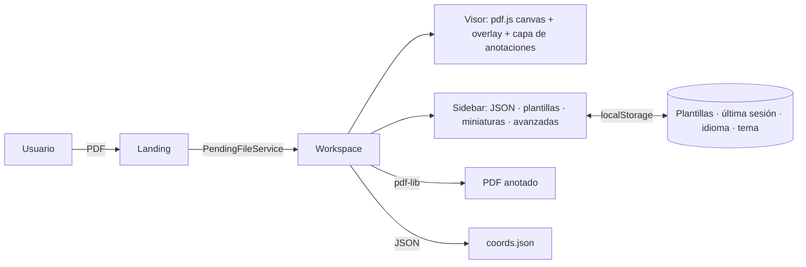

# Arquitectura de PDF Annotator

## 1. Visión general

Todo ocurre en el cliente. El servidor (NGINX) solo entrega estáticos con cabeceras de seguridad.

## 2. Flujo de datos
`coords: signal<PageAnnotations[]>` es la **única fuente de verdad**. Todo lo demás se deriva:

| Origen del cambio | Camino | Efecto |
| --- | --- | --- |
| Clic en el visor | `onHitboxClick` → `preview` → `confirmPreview` | añade campo a `coords` |
| Clic en anotación | `startEditing` → `editing` → `confirmEdit` | actualiza campo |
| Arrastre | `handleAnnotationPointerDown` → `updateAnnotationPosition` | mueve (con *snapping* si hay guías) |
| Texto JSON | `onCoordsTextChange` → `scheduleCoordsAutoApply` (300 ms) → `tryApplyCoordsText` | reemplaza `coords` conservando el texto |
| Importar archivo / plantilla | `onCoordsFileSelected` / `applyTemplate` → `replaceCoords` | reemplaza y re-serializa el JSON |
| Deshacer/Rehacer | `undoStack`/`redoStack` (instantáneas) | restaura `coords` |

Cada cambio pasa por `applyCoordsChange` (historial) → `syncCoordsTextModel` (JSON) → `redrawAllForPage` (DOM) y `storeLastCoords` (localStorage).

## 2b. Estado y historial
`AnnotationStore` (`services/annotation-store.ts`, provisto por `WorkspacePageComponent`, no global) guarda `coords` y las pilas de deshacer/rehacer. `applyChange(mutator)` toma una instantánea, ejecuta el cambio y solo registra historial si hubo diferencia real según el comparador que le da la página (`areFieldsEqual`, que normaliza campos). Las operaciones puras sobre páginas (añadir/actualizar/quitar campo, clonar, comparar) están en `utils/annotation-pages.utils.ts`. La página sigue orquestando la UI: tras deshacer/rehacer cierra editores, re-sincroniza el JSON y redibuja.

Los errores de sintaxis del JSON se lanzan como `LooseJsonError` (`utils/loose-json.ts`) con `line`/`column`. La página recalcula `jsonTreePreview` en cada cambio de texto (válido + nº de campos, error con posición o falta de `pages`) y la barra `.json-status` bajo el editor lo muestra; al aplicar o importar, `reportJsonImportError` convierte el error en un aviso con la posición.

El importador además rellena un `ImportReport` (campos y páginas omitidos, tamaños de fuente fuera de 8–72, opacidades fuera de 0,1–1) sin alterar el resultado. Tras aplicar o importar de forma explícita, `reportImportIssues` lo completa con comprobaciones que dependen del PDF (anotaciones fuera de la página según su tamaño real, páginas que no existen) y muestra un único aviso `warning`; el autoaplicado mientras se escribe es silencioso.

## 3. Modelo
```ts
type FieldType = 'text' | 'check' | 'radio' | 'number';
interface PageField { x; y; mapField; fontSize; color; type;
  value?; appender?; decimals?; fontFamily?; opacity?; backgroundColor?; locked?; hidden? }
interface PageAnnotations { num: number; fields: PageField[] }
```
- Texto pintado = `value` (si no está vacío) → `X` para `check/radio` → `mapField` (con `decimals` y `appender` para `number`).
- `hidden` no se exporta al PDF; `locked` impide editar/arrastrar.
- JSON mínimo: `x, y, mapField, fontSize, type`. Con *"Incluir propiedades avanzadas"*: además color, fuente, opacidad, fondo, `locked`, `hidden`, etc.
- Importación tolerante (`AnnotationImportService.normalizeImportedCoordinates`, con helpers puros en `utils/annotation-fields.utils.ts`): acepta array directo o `{ pages }`, normaliza colores, tipos, fuentes y opacidades.

## 4. Renderizado
1. `pdfjs-dist` (worker módulo en `/assets/pdfjs/pdf.worker.entry.mjs`, con *fallback* sin worker) pinta la página en `canvas.canvas--pdf` a `scale`.
2. `canvas--overlay`: rejilla, reglas y guías (`refreshOverlay`, `drawGrid`, `drawRulers`, `drawStaticGuides`, `drawActiveGuides`).
3. `.annotations-layer`: un `div` por anotación (creado con `textContent`).
4. `.hitbox`: captura clics/movimiento y calcula coordenadas PDF.
5. Editor flotante (`AnnotationEditorComponent`, `mode = 'preview' | 'edit'`) posicionado con `left = x·scale`, `top = canvas.height − y·scale`. El visor expone sus referencias (`previewEditorRef`, `editFontSearchRef`…) a la página sin cambiar su API.

Zoom: pasos de 0.25 (mín. 0.25), `fitWidth()` ajusta al ancho útil del visor (máx. 4×). En pantallas < 960 px se ajusta al cargar.

## 4b. Fuentes
`FontCatalogService` (`fonts/`) es la única fuente de verdad de las fuentes: familias estándar de PDF + fuentes personalizadas cargadas por el usuario (`FontFace` + bytes para incrustarlas al exportar). Expone señales (`customFonts`, `customFontsFeatureEnabled`, `fontOptions`) y resuelve los nombres "sueltos" del JSON importado (`resolveImportedFontFamily`, `collectFontFamilyCandidates`). La página solo gestiona la UI del desplegable y las alertas.

## 5. Exportación de PDF
`downloadAnnotatedPDF` (página) reúne los datos y delega en `PdfExportService.exportAnnotatedPdf`, que carga los bytes con `pdf-lib` probando hasta tres variantes (original, canónica, saneada) → embebe fuentes estándar o personalizadas (`fontkit` cargado bajo demanda) → dibuja fondo, texto y opacidad por anotación. La página guarda la variante que funcionó y descarga `annotated.pdf` con `downloadBlob`. Páginas inexistentes se ignoran con aviso. El servicio no conoce el estado de la página: recibe callbacks (`styleField`, `renderText`, `resolveFont`).

## 6. Persistencia (`localStorage`)
| Clave | Contenido |
| --- | --- |
| `pdf-annotator.templates` | Plantillas guardadas (páginas + ajustes de guías) |
| `pdf-annotator.last-coords` | Últimas anotaciones |
| `pdf-annotator.language` | Idioma |
| `pdf-annotator-theme` | Tema |

La plantilla "Predeterminada" es sintética y no se puede borrar. Todos los accesos están envueltos en `try/catch` (modo privado, cuota excedida).

## 6a. Navegación y guard
`/workspace` está protegida por `workspaceGuard`: sin un archivo pendiente en `PendingFileService` (recarga del navegador, URL directa, adelante/atrás) redirige a `/landing`, donde un banner permite retomar la sesión guardada. En el servidor (prerender) el guard deja pasar para no romper el HTML estático; la decisión se toma en el cliente.

## 6b. Sesión guardada (IndexedDB)
`SessionStoreService` guarda la última sesión (`pdf` como Blob, `coords`, `pageIndex`, `scale`, `savedAt`) en la base `pdf-annotator`, almacén `session`, clave `last`. La página la escribe con un debounce de 800 ms desde un `effect` sobre anotaciones, página y zoom (y la vuelca al salir con `pagehide`/`ngOnDestroy`); solo guarda si hay anotaciones o historial, y la borra al limpiar todas. PDFs de más de 40 MB no se guardan. La landing ofrece **Continuar** (pasa archivo y `PendingRestore` por `PendingFileService`; el workspace los aplica con `skipHistory`) o **Descartar**. Todos los accesos toleran IndexedDB bloqueada o llena.

## 7. Guías y snapping
`GuideSettings` (`models/guide-settings.model.ts`): rejilla (`gridSize`), reglas, alineación, *snap* a rejilla/márgenes/centros/puntos personalizados, `snapTolerance`, y modo de coordenadas (PDF o canvas). Se activan en **Opciones avanzadas → Activar guías y snapping**.

## 8. Internacionalización
`TranslationService` (signals) + pipe impura `t`. `scripts/check-translations.mjs` falla el build si falta una clave respecto a `es-ES`. Placeholders con `{{param}}`.

## 8b. Panel lateral
El sidebar tiene cuatro pestañas (patrón WAI-ARIA tabs: `role=tablist/tab/tabpanel`, flechas/Inicio/Fin): **Documento** (cambiar PDF, miniaturas), **Anotaciones** (editor/árbol JSON, importar/aplicar, contador en la insignia), **Plantillas** y **Avanzado** (fuentes, guías, campos extra del JSON). Las coordenadas del cursor quedan sobre las pestañas. La pestaña activa vive en `WorkspacePageComponent.sidebarTab`; los paneles inactivos se ocultan con `[hidden]` para no destruir sus referencias.

## 9. Layout y responsive
Shell `.app--workspace`: grid `header / sidebar+viewer / footer`, `100dvh`, scroll independiente en sidebar y visor. Sidebar `clamp(320px, 28vw, 440px)`, minimizable a 72 px (`B`). < 960 px: una columna (visor → panel). Cabecera: una fila; etiquetas ocultas < 1650 px (tooltips con atajo).

## 10. Seguridad
- Parser JSON sin evaluación (`utils/loose-json.ts`, ignora `__proto__`, profundidad máx. 64).
- Límite de 5 MB en JSON; validación de PDF por tipo/extensión; fuentes por extensión.
- `nginx.conf`: CSP, `nosniff`, `X-Frame-Options: DENY`, `Referrer-Policy`, `Permissions-Policy`, `server_tokens off`.
- Sin backend: el PDF nunca sale del navegador.

## 11. Deuda técnica y hoja de ruta
Ver [`PROPUESTA_MEJORAS.md`](../PROPUESTA_MEJORAS.md): dividir `workspace.page.ts`, extraer `<app-annotation-editor>`, pestañas en el sidebar, persistencia de sesión con IndexedDB, toasts en vez de `alert`.
