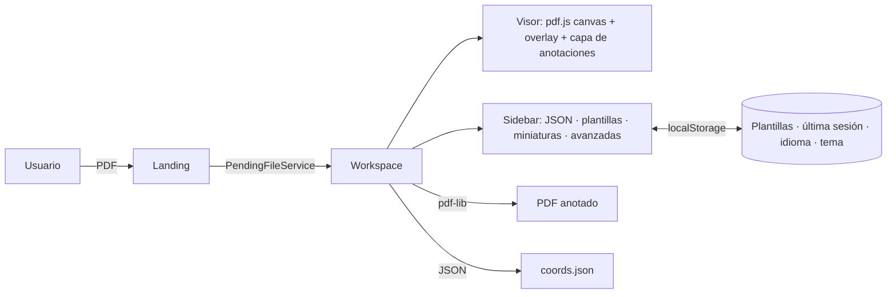

# Arquitectura de PDF Annotator

## 1. Visión general

Todo ocurre en el cliente. El servidor (NGINX) solo entrega estáticos con cabeceras de seguridad.

## 2. Flujo de datos
`coords: signal<PageAnnotations[]>` es la **única fuente de verdad**. Todo lo demás se deriva:

| Origen del cambio | Camino | Efecto |
| --- | --- | --- |
| Clic en el visor | `onHitboxClick` → `preview` → `confirmPreview` | añade campo a `coords` |
| Clic en anotación | `startEditing` → `editing` → `confirmEdit` | actualiza campo |
| Arrastre | `handleAnnotationPointerDown` → `updateAnnotationPosition` | mueve (con *snapping* si hay guías) |
| Texto JSON | `onCoordsTextChange` → `scheduleCoordsAutoApply` (300 ms) → `tryApplyCoordsText` | reemplaza `coords` conservando el texto |
| Importar archivo / plantilla | `onCoordsFileSelected` / `applyTemplate` → `replaceCoords` | reemplaza y re-serializa el JSON |
| Deshacer/Rehacer | `undoStack`/`redoStack` (instantáneas) | restaura `coords` |

Cada cambio pasa por `applyCoordsChange` (historial) → `syncCoordsTextModel` (JSON) → `redrawAllForPage` (DOM) y `storeLastCoords` (localStorage).

## 2b. Estado y historial
`AnnotationStore` (`services/annotation-store.ts`, provisto por `WorkspacePageComponent`, no global) guarda `coords` y las pilas de deshacer/rehacer. `applyChange(mutator)` toma una instantánea, ejecuta el cambio y solo registra historial si hubo diferencia real según el comparador que le da la página (`areFieldsEqual`, que normaliza campos). Las operaciones puras sobre páginas (añadir/actualizar/quitar campo, clonar, comparar) están en `utils/annotation-pages.utils.ts`. La página sigue orquestando la UI: tras deshacer/rehacer cierra editores, re-sincroniza el JSON y redibuja.

Los errores de sintaxis del JSON se lanzan como `LooseJsonError` (`utils/loose-json.ts`) con `line`/`column`. La página recalcula `jsonTreePreview` en cada cambio de texto (válido + nº de campos, error con posición o falta de `pages`) y la barra `.json-status` bajo el editor lo muestra; al aplicar o importar, `reportJsonImportError` convierte el error en un aviso con la posición.

El importador además rellena un `ImportReport` (campos y páginas omitidos, tamaños de fuente fuera de 8–72, opacidades fuera de 0,1–1) sin alterar el resultado. Tras aplicar o importar de forma explícita, `reportImportIssues` lo completa con comprobaciones que dependen del PDF (anotaciones fuera de la página según su tamaño real, páginas que no existen) y muestra un único aviso `warning`; el autoaplicado mientras se escribe es silencioso.

## 2c. Selección múltiple
`WorkspacePageComponent.selection` guarda `{ pageIndex, fields[] }` (siempre una sola página, sin anotaciones bloqueadas). Se llena con Shift/Ctrl+clic (`toggleSelection`) o Ctrl+A (`selectAllOnPage`) y se pinta con la clase `annotation--selected` (`redrawAllForPage` marca cada `.annotation` con `data-page-index`/`data-field-index`). Acciones: arrastre en grupo (`startGroupDrag`: el delta se limita para que ningún miembro salga de la página y se mantenga la separación), `moveSelection` (flechas), `alignSelection` (`alignBoxes` sobre cajas en puntos PDF con el ancho real del DOM y `height = fontSize`), borrar, copiar/pegar y duplicar. Cada acción es **un** paso de historial mediante `updateSelectedFields`; las pulsaciones repetidas de flecha comparten `coalesceKey` y `AnnotationStore.applyChange` las fusiona si ocurren a menos de 800 ms. El recuadro (`lasso`) se dibuja sobre la página mientras se arrastra en una zona vacía (umbral de 4 px; un clic sin arrastre sigue creando una anotación) y al soltar selecciona las anotaciones no bloqueadas cuyo rectángulo del DOM lo toca (con Shift suma a la selección). `distributeSelection` reparte con huecos iguales entre los extremos (`distributeBoxes`, mínimo 3). `render()` está serializado: una llamada durante un render en curso solo marca "repetir" y se repinta al final.

## 3. Modelo
```ts
type FieldType = 'text' | 'check' | 'radio' | 'number';
interface PageField { x; y; mapField; fontSize; color; type;
  value?; appender?; decimals?; fontFamily?; opacity?; backgroundColor?; locked?; hidden? }
interface PageAnnotations { num: number; fields: PageField[] }
```
- Texto pintado = `value` (si no está vacío) → `X` para `check/radio` → `mapField` (con `decimals` y `appender` para `number`).
- `hidden` no se exporta al PDF; `locked` impide editar/arrastrar.
- JSON mínimo: `x, y, mapField, fontSize, type`. Con *"Incluir propiedades avanzadas"*: además color, fuente, opacidad, fondo, `locked`, `hidden`, etc.
- Importación tolerante (`AnnotationImportService.normalizeImportedCoordinates`, con helpers puros en `utils/annotation-fields.utils.ts`): acepta array directo o `{ pages }`, normaliza colores, tipos, fuentes y opacidades.

## 4. Renderizado
1. `pdfjs-dist` (worker módulo en `/assets/pdfjs/pdf.worker.entry.mjs`, con *fallback* sin worker) pinta la página en `canvas.canvas--pdf` a `scale`.
2. `canvas--overlay`: rejilla, reglas y guías (`refreshOverlay`, `drawGrid`, `drawRulers`, `drawStaticGuides`, `drawActiveGuides`).
3. `.annotations-layer`: un `div` por anotación (creado con `textContent`).
4. `.hitbox`: captura clics/movimiento y calcula coordenadas PDF.
5. Editor flotante (`AnnotationEditorComponent`, `mode = 'preview' | 'edit'`) posicionado con `left = x·scale`, `top = canvas.height − y·scale`. El visor expone sus referencias (`previewEditorRef`, `editFontSearchRef`…) a la página sin cambiar su API.

Zoom: pasos de 0.25 (mín. 0.25), `fitWidth()` ajusta al ancho útil del visor (máx. 4×). En pantallas < 960 px se ajusta al cargar.

## 4b. Fuentes
`FontCatalogService` (`fonts/`) es la única fuente de verdad de las fuentes: familias estándar de PDF + fuentes personalizadas cargadas por el usuario (`FontFace` + bytes para incrustarlas al exportar). Expone señales (`customFonts`, `customFontsFeatureEnabled`, `fontOptions`) y resuelve los nombres "sueltos" del JSON importado (`resolveImportedFontFamily`, `collectFontFamilyCandidates`). La página solo gestiona la UI del desplegable y las alertas.

## 5. Exportación de PDF
`downloadAnnotatedPDF` (página) reúne los datos y delega en `PdfExportService.exportAnnotatedPdf`, que carga los bytes con `pdf-lib` probando hasta tres variantes (original, canónica, saneada) → embebe fuentes estándar o personalizadas (`fontkit` cargado bajo demanda) → dibuja fondo, texto y opacidad por anotación. La página guarda la variante que funcionó y descarga `annotated.pdf` con `downloadBlob`. Páginas inexistentes se ignoran con aviso. El servicio no conoce el estado de la página: recibe callbacks (`styleField`, `renderText`, `resolveFont`).

## 6. Persistencia (`localStorage`)
| Clave | Contenido |
| --- | --- |
| `pdf-annotator.templates` | Plantillas guardadas (páginas + ajustes de guías) |
| `pdf-annotator.last-coords` | Últimas anotaciones |
| `pdf-annotator.language` | Idioma |
| `pdf-annotator-theme` | Tema |

La plantilla "Predeterminada" es sintética y no se puede borrar. Todos los accesos están envueltos en `try/catch` (modo privado, cuota excedida).

## 6a. Navegación y guard
`/workspace` está protegida por `workspaceGuard` (asíncrono). Si no hay un archivo pendiente en `PendingFileService` (recarga, URL directa, adelante/atrás) intenta reabrir, por este orden: el PDF del lote de `?lote=<id>` (`BATCH_ITEM_PARAM`; lo activa en `BatchStoreService` y, si ya no existe, va a `/lote`), el último PDF suelto abierto en esta visita (`rememberLastOpened`, lo deja `workspace.page.ts` al salir; solo en memoria) y la sesión de IndexedDB. Sin nada que reabrir redirige a `/landing`. El panel del lote abre cada PDF con `?lote=<id>` y «anterior/siguiente» cambia la URL con `replaceUrl`; lo que se abre de un PDF del lote sale de `utils/batch-open.utils.ts`. El logo de la barra del editor es un enlace a `/landing`. En el servidor (prerender) el guard deja pasar para no romper el HTML estático; la decisión se toma en el cliente.

## 6b. Sesión guardada (IndexedDB)
`SessionStoreService` guarda la última sesión (`pdf` como Blob, `coords`, `pageIndex`, `scale`, `savedAt`) en la base `pdf-annotator`, almacén `session`, clave `last`. La página la escribe con un debounce de 800 ms desde un `effect` sobre anotaciones, página y zoom (y la vuelca al salir con `pagehide`/`ngOnDestroy`); solo guarda si hay anotaciones o historial, y la borra al limpiar todas. PDFs de más de 40 MB no se guardan. La landing ofrece **Continuar** (pasa archivo y `PendingRestore` por `PendingFileService`; el workspace los aplica con `skipHistory`) o **Descartar**. Todos los accesos toleran IndexedDB bloqueada o llena.

## 6c. Proyectos locales (solo escritorio)
Un proyecto = una carpeta visible del disco bajo la raíz (`Documentos/PDF Annotator`, ajustable): `project.json`, `batch/<id>.json` (metadatos del `BatchItem`), `batch/<id>.a.pdf` / `.b.pdf` y `.lock`. El proceso principal (`desktop/projects.mjs` = lógica pura con tests; `desktop/projects-ipc.mjs` = canales `projects:*`, valida rutas contra la raíz y exige tener el bloqueo para escribir) se expone en `window.desktop.projects` (`preload.cjs`, tipos en `models/project.model.ts`). En la página, `ProjectStoreService` abre un proyecto cargando sus PDFs en `BatchStoreService` (`attachProject`) y registra un `BatchSink` que refleja cada cambio en la carpeta con debounce (los PDFs ya escritos no se reescriben); en solo lectura no se guarda nada y, si otro equipo toma el bloqueo (`not-held`), pasa a solo lectura con un aviso. Con proyecto activo el lote no usa IndexedDB. Tras recargar, `BatchStoreService.load()` pide a `ProjectStoreService.restore()` reabrir el proyecto (el bloqueo sigue en el proceso principal). Tope y avisos: `LIMITS` en `projects.mjs` (200 PDFs, 2 GB, aviso desde 100 PDFs o 1 GB, 40 MB por PDF). Pantalla: `pages/projects`. Las fases 2 (importar/exportar) y 3 (sincronizar) están en `docs/ROADMAP.md`.

### Exportar e importar proyectos (fase 2)
Un archivo `.pdfannotator` (ZIP versionado, formato en `docs/DOMAIN.md`) lleva un proyecto a otro equipo. Todo el trabajo pesado vive en el proceso principal: `desktop/project-archive.mjs` (escritor y lector de ZIP propios con `node:zlib`, sin dependencias; `exportProject`, `inspectArchive`, `importArchive`, `replaceImpact`; tests en `project-archive.test.mjs`) y los manejadores `projects:export-info`, `projects:export`, `projects:reveal`, `projects:import-inspect`, `projects:import-run`, `projects:cancel` en `projects-ipc.mjs`. Reglas: una sola operación a la vez; las funciones ceden el turno al bucle de eventos entre PDFs (la ventana sigue viva, hay progreso `projects:progress` y se puede cancelar); exportar escribe `*.part` y renombra al terminar; importar revisa el archivo entero (rutas, nombres permitidos, tamaños declarados y reales, CRC, SHA-256 del manifiesto, cabecera `%PDF-`, tope de PDFs/bytes, formato más nuevo) y escribe en `.import-<uuid>/` dentro de la raíz, que solo se mueve a su sitio si todo salió bien. «Importar» actúa sobre el último archivo revisado en el proceso principal, no sobre una ruta que mande la web. «Reemplazar» aparta antes el proyecto actual en `<carpeta>-antes-de-importar`. El renderizador (`ProjectTransferService` + diálogos en `pages/projects`) solo guarda el estado de los diálogos y el avance.

### Sincronizar con una carpeta enlazada (fase 3)
`desktop/project-sync.mjs` (motor sobre un proveedor de carpeta o SFTP, ver la sección siguiente; tests en `project-sync.test.mjs`) y los manejadores `sync:*` de `projects-ipc.mjs` (`sync:status`, `sync:choose`, `sync:link`, `sync:unlink`, `sync:all`, `sync:project`, `sync:reveal`; el evento `projects:sync-event` avisa de subidas en segundo plano). Modelo: copia local + carpeta de encuentro. La ruta de la carpeta enlazada se guarda en `userData/projects-sync.json`; el estado de cada proyecto, en `<proyecto>/.sync.json` (`projectId`, `baseRev`, huellas y fechas de la última sincronización, `paused`); sin ese archivo el proyecto no se sincroniza. En la carpeta enlazada: los mismos archivos del proyecto (`project.json`, `batch/…`), `.sync/rev.json` (revisión, quién subió, huella de cada archivo; se escribe la última y es la «confirmación»), `.sync/lock.json` (bloqueo remoto) y `.sync/backups/rev<N>/` (lo sustituido al elegir «subir la mía»). Reglas: todo lo leído de la carpeta enlazada es no confiable (nombres de archivo con lista blanca, huellas verificadas antes de sustituir nada); subir escribe `*.part` y renombra; bajar copia a `.sync-tmp/`, verifica y solo entonces sustituye; no se pisa nada si cambiaron los dos lados (`conflict` → `theirs`, que guarda lo local como proyecto «… (conflicto d mes)», o `mine`, que respalda lo sustituido); la app nunca borra de la carpeta enlazada nada que no sea archivo del proyecto. Estados de tarjeta (`projectStatus`): none, sync, pend, pull, other, conflict, off, paused; detecta copias en conflicto del servicio de sincronización (`strays`). Bloqueo: al abrir un proyecto sincronizado se toma el local y luego el remoto (escribe, espera 3 s, relee; gana el más antiguo); `projects:renew` renueva ambos (el remoto cada 2 min) y caduca a los 15 min; al cerrar se suben los cambios en segundo plano y después se suelta el remoto; `syncHeld` sube cada 3 min los proyectos abiertos con cambios. Una sincronización a la vez (`exclusive`), con progreso y cancelación. El renderizador (`ProjectSyncService` + diálogos en `pages/projects`) solo guarda el estado de las tarjetas y los diálogos; consulta `sync:status` cada 30 s.

### Sincronizar con un servidor SFTP (fase 3b)
El motor de la fase 3 (`desktop/project-sync.mjs`) no habla con el disco enlazado directamente: usa un **proveedor** de `desktop/sync-provider.mjs` con rutas relativas a su base y separadas por «/» (`reachable`, `readJson`, `writeAtomic`, `createExclusive`, `stat`, `list`, `upload`, `download`, `rename`, `remove`, `mkdirp`, `free`, `now`, `lockAge`, `probeWrite`, `close`). `localProvider(base)` es la carpeta del equipo (bloqueo escribe-espera-relee, copias en conflicto del servicio de nube); `sftpProvider({ client, sftp, base, … })` es un servidor (`ssh2`): bloqueo con `open(…, 'wx')` (gana el primero), caducidad con la hora del servidor (`lockAge`, desfase medido con `measureClockOffset`), `posix-rename@openssh.com` si existe (si no, borrar el destino y renombrar; si el servidor no renombra → `rename-unsupported` y no se sube), subida a `.part` + renombrado y `fastPut/fastGet` con `step` para los bytes. Toda llamada compite con el cierre de la conexión (ssh2 no responde a lo pendiente al caerse) y los fallos se traducen a `connection-lost`, `folder-readonly`, `disk-full`, `remote-incomplete`… Una subida interrumpida deja en `.sync.json` los archivos que llegaron enteros (`partial` + `partialRev`) y al reintentar no se repiten.
`desktop/sftp-connection.mjs` abre la sesión: `inspectHost` lee la huella sin enviar credenciales, `openSftpProvider` exige la huella fijada (`host-key-unknown` / `host-key-changed` antes de enviar nada), `testConnection` hace la «prueba de conexión» y `loadPrivateKey` valida el archivo de clave (≤ 64 KB, OpenSSH/PEM, frase de paso). `desktop/sync-secrets.mjs` guarda la contraseña o la frase de paso con `safeStorage` en `userData/projects-sync-secret.bin`; en Linux se tratan `basic_text` y `unknown` como «sin almacén seguro»: no se escribe nada en disco y el secreto vive solo en memoria durante la sesión. El destino enlazado se guarda en `userData/projects-sync.json` (`{ kind: 'folder', folder }` o `{ kind: 'sftp', host, port, username, path, authMode, keyFile, fingerprint, hostKeyType }`, nunca el secreto). Canales nuevos en `projects-ipc.mjs`: `sync:sftp-choose-key`, `sync:sftp-inspect`, `sync:sftp-trust`, `sync:sftp-test`, `sync:sftp-credential`, `sync:sftp-forget`; `sync:status` devuelve `kind`, `label`, `server` (sin secretos, con `credentialSaved`/`secureStore`) y `offlineReason`. «Vincular» actúa solo sobre lo último que el usuario eligió y comprobó en el proceso principal; la huella que se acepta es la última que se mostró (`inspectedHost`). Al desvincular se borra también la credencial. Al salir (`before-quit`) se sueltan los bloqueos del servidor con un margen de 3 s. `desktop/test-sftp-server.mjs` (servidor SFTP mínimo sobre `ssh2`, solo para pruebas) permite probar sin servidor real: huella, claves, solo lectura, sin renombrar, cortes y relojes desajustados. En la web, `ProjectSyncService` lleva el formulario y los diálogos (`link` con pestañas, `sftp-test`, `hostkey`, `credential`, `nostore`, `server`, `forget`, `unlink-sftp`) y las credenciales que se escriben se envían una sola vez y se borran.

## 7. Guías y snapping
`GuideSettings` (`models/guide-settings.model.ts`): rejilla (`gridSize`), reglas, alineación, *snap* a rejilla/márgenes/centros/puntos personalizados, `snapTolerance`, y modo de coordenadas (PDF o canvas). Se activan en **Opciones avanzadas → Activar guías y snapping**.

## 8. Internacionalización
`TranslationService` (signals) + pipe impura `t`. `scripts/check-translations.mjs` falla el build si falta una clave respecto a `es-ES`. Placeholders con `{{param}}`.

## 8b. Panel lateral
El sidebar tiene cuatro pestañas (patrón WAI-ARIA tabs: `role=tablist/tab/tabpanel`, flechas/Inicio/Fin): **Documento** (cambiar PDF, miniaturas), **Anotaciones** (editor/árbol JSON, importar/aplicar, contador en la insignia), **Plantillas** y **Avanzado** (fuentes, guías, campos extra del JSON). Las coordenadas del cursor quedan sobre las pestañas. La pestaña activa vive en `WorkspacePageComponent.sidebarTab`; los paneles inactivos se ocultan con `[hidden]` para no destruir sus referencias.

## 9. Layout (diseñado solo para escritorio)
Shell `.app--workspace`: grid `header / sidebar+viewer / footer`, `100dvh`, scroll independiente en sidebar y visor. Sidebar `clamp(320px, 28vw, 440px)`, minimizable a 72 px (`B`). El CSS tiene un modo de una columna por debajo de 960 px (visor → panel): se conserva pero no se diseña ni se prueba como producto (decisión 11). Cabecera: una fila; etiquetas ocultas < 1650 px (tooltips con atajo).

## 10. Seguridad
- Parser JSON sin evaluación (`utils/loose-json.ts`, ignora `__proto__`, profundidad máx. 64).
- Límite de 5 MB en JSON; validación de PDF por tipo/extensión; fuentes por extensión.
- `nginx.conf`: CSP, `nosniff`, `X-Frame-Options: DENY`, `Referrer-Policy`, `Permissions-Policy`, `server_tokens off`.
- Sin backend: el PDF nunca sale del navegador.

## 10b. App de escritorio (Electron)
`desktop/` (paquete propio con `electron-updater`; la versión se copia de `package.json` con `scripts/sync-desktop-version.mjs`). `main.mjs` sirve `dist/pdf-annotator/browser` con el protocolo `app://pdf-annotator` (fallback SPA a `index.csr.html`, misma CSP que `nginx.conf` más `connect-src` al ayudante), lanza `tools/ai-helper/server.mjs` con `ELECTRON_RUN_AS_NODE=1` (puerto 4310, origen `app://pdf-annotator`, PATH del shell de login para encontrar `claude`/`copilot`) y gestiona las actualizaciones. `preload.cjs` expone solo `window.desktop` (ventana con `contextIsolation` y `sandbox`). En la web, `services/desktop-update.service.ts` + `components/update-card` (diseño AC-01) pintan el aviso; `update-logic.mjs` (puro, con tests) decide versión y modo (`auto`: Windows NSIS, AppImage y deb/rpm —leídos de `resources/package-type`—, que se instalan con `pkexec`; `manual`: macOS sin firma y Linux sin formato reconocido). `after-pack.cjs` copia las `node_modules` del ayudante porque `extraResources` no las incluye. `history-nav.mjs` (puro, con tests) da Atrás/Adelante a la ventana: `Alt+←/→` (`⌘[`/`⌘]` en macOS) en `before-input-event`, botones laterales del ratón (`app-command`) y deslizar (`swipe`). Pruebas: `npm run test:desktop` y `node desktop/smoke.mjs` (Electron real con xvfb en Linux). Canal de actualizaciones: `stable` (por defecto) o `beta` (también RC `X.Y.Z-rc.N`), guardado en `update-channel.json` de `userData`; `parseReleaseForChannel` (puro) elige la release en modo manual y `autoUpdater.allowPrerelease` en el automático; la web lo cambia con `window.desktop.setUpdateChannel` desde `components/update-channel`, que vive dentro del panel «Versión y actualizaciones» (`components/update-panel`, mesas AC-10 a AC-12). Ese panel se abre desde el chip de versión (`components/version-chip`, en landing, lote y editor; con punto cuando hay novedad) o desde el menú nativo Ayuda → «Buscar actualizaciones…» (`desktop:update:open-panel`, `onOpenUpdates`); el estado lleva `checking`, `lastChecked` e `installOnQuit`, y «Buscar ahora» es `checkNow()`. Releases: `.github/workflows/desktop-release.yml` (finales) y `release-candidate.yml` (RC como pre-release). Variables de prueba: `PDF_ANNOTATOR_RELEASE_API` y `PDF_ANNOTATOR_UPDATE_URL` (feed alternativo).

## 11. Deuda técnica y hoja de ruta
Ver [`ROADMAP.md`](ROADMAP.md). Pendiente principal: dividir `workspace.page.ts` (render del PDF, miniaturas y sincronización del JSON).
