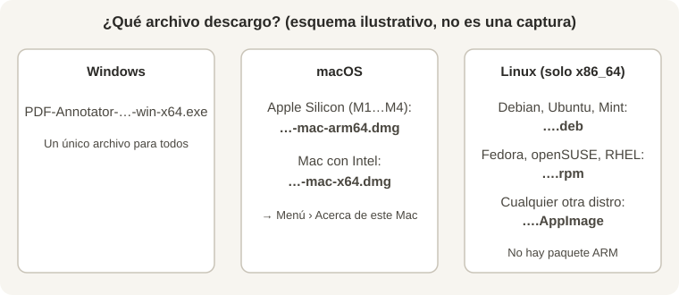

# Cómo instalar PDF Annotator (app de escritorio)

Guía paso a paso para **cualquier persona**, sepa o no de informática. Si solo quieres probarla, no hace falta instalar nada: funciona también en el navegador.

> Todos los enlaces llevan a la **[última release](https://github.com/ElMaxter99/pdf-annotator/releases/latest)**. Los archivos llevan el número de versión en el nombre (por ejemplo `PDF-Annotator-1.8.1-win-x64.exe`); usa el que corresponda a tu sistema, la versión no importa.

**Ir directo a tu sistema:** [🪟 Windows](#windows) · [🍎 macOS](#macos) · [🐧 Linux](#linux)



## Antes de empezar: dónde está el archivo
1. Abre la [última release](https://github.com/ElMaxter99/pdf-annotator/releases/latest).
2. Baja hasta la sección **Assets** (si ves «Show all assets», púlsala).
3. Haz clic en el archivo de tu sistema (tabla de abajo) y espera a que se descargue.

<!-- CAPTURA: instalacion/win-01-assets.png (lista Assets de la release con el archivo resaltado) -->

| Tu sistema | Archivo |
| --- | --- |
| Windows 10/11 (64 bits) | `…-win-x64.exe` |
| Mac con chip Apple (M1, M2, M3, M4…) | `…-mac-arm64.dmg` |
| Mac con procesador Intel | `…-mac-x64.dmg` |
| Debian, Ubuntu, Linux Mint, Pop!_OS | `…-linux-amd64.deb` |
| Fedora, openSUSE, RHEL, Rocky, Alma | `…-linux-x86_64.rpm` |
| Cualquier otra distribución | `…-linux-x86_64.AppImage` |

Los `.zip` de macOS son equivalentes al `.dmg`; no los necesitas.

> **Aviso sobre las firmas.** Los instaladores **no están firmados** con un certificado de pago, así que Windows y macOS mostrarán un aviso la primera vez. Es normal y esperado; abajo se explica cómo continuar. Si prefieres no hacerlo, usa la versión web.

---

## Windows
Requisitos: Windows 10 u 11 de 64 bits.

1. Descarga `PDF-Annotator-…-win-x64.exe`.
2. Haz **doble clic** en el archivo (suele estar en *Descargas*).
3. Si aparece **«Windows protegió su PC»** (SmartScreen): pulsa **Más información** y después **Ejecutar de todas formas**.
   <!-- CAPTURA: instalacion/win-02-smartscreen.png y win-03-ejecutar.png -->
4. Si Windows pregunta si permites que la aplicación haga cambios, pulsa **Sí**.
5. Sigue el asistente: puedes dejar la carpeta que propone o cambiarla, y pulsa **Instalar**. Se instala solo para tu usuario, sin pedir permisos de administrador.
   <!-- CAPTURA: instalacion/win-04-asistente.png -->
6. Al terminar, abre **PDF Annotator** desde el menú Inicio o el icono del escritorio.

**Actualizaciones:** automáticas. La app avisa cuando hay versión nueva y pulsas «Actualizar ahora».

## macOS
Requisitos: macOS reciente. Hay dos versiones; elige la de tu Mac.

**¿Apple Silicon o Intel?** Menú  (arriba a la izquierda) › **Acerca de este Mac**. Si pone «Chip: Apple M…» → `arm64`. Si pone «Procesador: Intel…» → `x64`.
<!-- CAPTURA: instalacion/mac-01-acerca-de.png -->

1. Descarga `PDF-Annotator-…-mac-arm64.dmg` (Apple) o `…-mac-x64.dmg` (Intel).
2. Ábrelo con doble clic. Se abre una ventana con el icono de la app y la carpeta *Aplicaciones*.
3. **Arrastra** PDF Annotator a *Aplicaciones*.
   <!-- CAPTURA: instalacion/mac-02-arrastrar.png -->
4. Abre *Aplicaciones* y haz **clic derecho (o Control + clic) sobre PDF Annotator › Abrir**, y confirma con **Abrir**. Solo hace falta la primera vez.
5. Si macOS dice que no puede abrirla: **Ajustes del Sistema › Privacidad y seguridad**, baja hasta el aviso sobre PDF Annotator y pulsa **Abrir igualmente**.
   <!-- CAPTURA: instalacion/mac-03-bloqueo.png y mac-04-privacidad.png -->
6. Si dice que la app **«está dañada»**, abre *Terminal* y ejecuta una vez:
   ```bash
   xattr -cr "/Applications/PDF Annotator.app"
   ```

**Actualizaciones:** la app avisa, pero en macOS el botón **abre la página de descargas**: descarga el nuevo `.dmg` y reemplaza la app en *Aplicaciones*.

## Linux
> **Solo se publica para x86_64 (PC de 64 bits, Intel/AMD).** No hay paquete ARM (Raspberry Pi, portátiles ARM…). Si tu equipo es ARM, usa la versión web. Para comprobarlo: `uname -m` debe responder `x86_64`.

Elige **uno** de estos formatos:

### `.deb` — Debian, Ubuntu, Linux Mint, Pop!_OS
1. Descarga `PDF-Annotator-…-linux-amd64.deb`.
2. Doble clic (se abre el instalador de software) y **Instalar**, o desde una terminal en la carpeta de descargas:
   ```bash
   sudo apt install ./PDF-Annotator-*-linux-amd64.deb
   ```
   <!-- CAPTURA: instalacion/linux-01-deb.png -->
3. Busca **PDF Annotator** en el menú de aplicaciones.

### `.rpm` — Fedora, openSUSE, RHEL, Rocky, Alma
1. Descarga `PDF-Annotator-…-linux-x86_64.rpm`.
2. Instálalo:
   ```bash
   sudo dnf install ./PDF-Annotator-*-linux-x86_64.rpm     # Fedora / RHEL
   sudo zypper install ./PDF-Annotator-*-linux-x86_64.rpm  # openSUSE
   ```

### `.AppImage` — cualquier distribución, sin instalar
1. Descarga `PDF-Annotator-…-linux-x86_64.AppImage`.
2. Dale permiso de ejecución: clic derecho › Propiedades › **Permitir ejecutar como programa**, o:
   ```bash
   chmod +x PDF-Annotator-*-linux-x86_64.AppImage
   ./PDF-Annotator-*-linux-x86_64.AppImage
   ```
   <!-- CAPTURA: instalacion/linux-02-appimage.png -->
3. Si no abre y habla de **FUSE**, instala `libfuse2` (Ubuntu/Debian: `sudo apt install libfuse2`; en Ubuntu 24.04: `libfuse2t64`).

**Actualizaciones:** el AppImage se actualiza solo. Con `.deb` y `.rpm` el botón del aviso abre la página de descargas y reinstalas el paquete nuevo.

---

## Activar la IA local (opcional)
La app instalada arranca sola el ayudante de IA, pero necesitas tener **`claude` o `copilot` instalado y con la sesión iniciada** en tu equipo. No se manejan claves ni credenciales. Detalle y privacidad (qué se envía): [`IA-LOCAL.md`](IA-LOCAL.md).

## Problemas frecuentes
| Síntoma | Qué hacer |
| --- | --- |
| No sé si bajar `arm64` o `x64` | Mira «Acerca de este Mac» (arriba) |
| Busco una versión ARM de Linux | No existe; usa la web |
| Windows o macOS bloquean la app | Es el aviso por no estar firmada; sigue los pasos de tu sistema |
| El AppImage no se abre | Permiso de ejecución y `libfuse2` |
| No aparece ningún instalador en la release | Aún no se ha publicado; usa la web mientras tanto |
