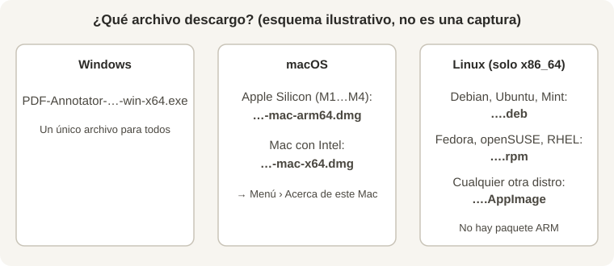

# Capturas de la guía de instalación

Las guías [`../INSTALAR.md`](../INSTALAR.md) usan este esquema ilustrativo (no es una captura real):

Las capturas reales de los diálogos de cada sistema aún no están hechas. Cada hueco de la guía lleva un comentario `<!-- CAPTURA: … -->`. Nombres previstos (PNG en esta carpeta):

| Archivo | Qué muestra |
| --- | --- |
| `win-01-assets.png` | Lista «Assets» de la última release con el `.exe` resaltado |
| `win-02-smartscreen.png` | Aviso azul «Windows protegió su PC» con «Más información» |
| `win-03-ejecutar.png` | El mismo aviso con el botón «Ejecutar de todas formas» |
| `win-04-asistente.png` | Asistente de instalación (carpeta de destino) |
| `mac-01-acerca-de.png` | «Acerca de este Mac» con el chip (Apple / Intel) |
| `mac-02-arrastrar.png` | Ventana del `.dmg` con el icono arrastrado a Aplicaciones |
| `mac-03-bloqueo.png` | Aviso de Gatekeeper («no se puede abrir…») |
| `mac-04-privacidad.png` | Ajustes › Privacidad y seguridad › «Abrir igualmente» |
| `linux-01-deb.png` | Instalador de software de Ubuntu con el `.deb` |
| `linux-02-appimage.png` | Propiedades del AppImage › «Permitir ejecutar como programa» |
